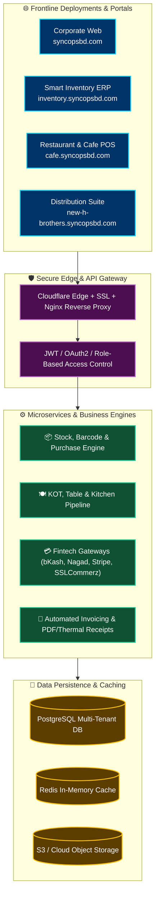

<div align="center">

<!-- ======================= TOP WAVE BANNER ======================= -->


<!-- ======================= ANIMATED TECH ILLUSTRATION ======================= -->
<p align="center">
  
</p>

<!-- ======================= DUAL-LINE TYPING EFFECT ======================= -->
<a href="https://syncopsbd.com">
  
</a>

<p align="center">
  <b>SyncOps BD</b> is a premier software engineering studio delivering mission-critical enterprise applications.<br/>
  We transform businesses with tailored ERPs, automated cloud POS systems, and modern digital architectures.
</p>

<!-- ======================= LIVE STATUS PILLS ======================= -->
<p align="center">
  <a href="https://syncopsbd.com"></a>
  <a href="mailto:support@syncopsbd.com"></a>
  <a href="https://wa.me/8801943006504"></a>
  
  
</p>


</div>

---

### 💻 System Terminal / Live Diagnostic

```jsonc
// ⚡ Querying SyncOps BD Production Core ...
{
  "organization": "SyncOps BD",
  "founder": "Nahidul Islam",
  "headquarters": "Dhaka, Bangladesh 🇧🇩",
  "core_competencies": [
    "Enterprise ERP & Multi-Branch Inventory",
    "Smart Dining, KOT & Restaurant POS",
    "High-Performance Web & Mobile Apps",
    "Legacy Code Refactoring & Microservices Modernization",
    "24/7 Cloud DevOps & SLA Maintenance"
  ],
  "production_uptime": "99.98%",
  "deployment_status": "Ready for high-scale enterprise operations 🚀"
}
```

---

### 🌐 Flagship Platforms & Live Deployments

Explore our running production instances and live enterprise solutions:

<div align="center">

| 🏢 Platform | ⚙️ Description & Key Modules | 🚀 Live Status & Access |
| :--- | :--- | :---: |
| <br/>**Corporate Hub** | **Corporate Portal & Service Architecture**<br/>• Next.js App Router & Tailwind CSS<br/>• Full product catalog & direct consultations<br/>• 24/7 client ticket resolution pipeline | <a href="https://syncopsbd.com" target="_blank"></a><br/><sub>[Visit Website](https://syncopsbd.com)</sub> |
| <br/>**Cloud Inventory** | **Enterprise Multi-Branch Inventory & POS**<br/>• Central warehouse & distributed branch stock tracking<br/>• Real-time barcode scanning & instant billing<br/>• Automated accounting, supplier purchase & audit reports | <a href="https://inventory.syncopsbd.com" target="_blank"></a><br/><sub>[Launch ERP](https://inventory.syncopsbd.com)</sub> |
| <br/>**Restaurant POS** | **Smart Restaurant, Cafe & KOT System**<br/>• Real-time Kitchen Order Ticket (KOT) sync<br/>• Visual dine-in table layout, takeaway & online orders<br/>• Split payments, recipe cost tracking & day-end audits | <a href="https://cafe.syncopsbd.com" target="_blank"></a><br/><sub>[Launch Cafe POS](https://cafe.syncopsbd.com)</sub> |
| <br/>**Client ERP** | **Tailored Wholesale & Distribution Suite**<br/>• Enterprise bulk distribution logistics<br/>• Customer credit ledger, receivables & payables<br/>• Granular multi-tier role-based permissions | <a href="https://new-h-brothers.syncopsbd.com" target="_blank"></a><br/><sub>[Access Deployment](https://new-h-brothers.syncopsbd.com)</sub> |

</div>

---

### 🏗️ Architecture & Cloud Ecosystem



---

### 🛠️ Cutting-Edge Tech Stack

<div align="center">

<!-- Animated Skill Icons with Dark Theme -->
<a href="https://skillicons.dev">
  
</a>

<br/><br/>

| Domain | Battle-Tested Technologies & Frameworks |
| :--- | :--- |
| **Frontend & UI/UX** |      |
| **Mobile Applications** |     |
| **Backend & APIs** |     |
| **Databases & Cache** |     |
| **Cloud & DevOps** |      |
| **Fintech Gateways** |     |

</div>

---

### ⚡ Core Solutions Breakdown

<details open>
<summary><b>📦 1. Enterprise Inventory & Multi-Branch ERP System</b></summary>
<br/>

Engineered for wholesalers, distributors, retail chains, and multi-location warehouses.
- **Stock Tracking & Serial/Batch Control:** Track product variations, expiry dates, and automated low-stock reorder triggers.
- **Thermal & A4 POS Billing:** Sub-second checkout speed with offline cache fallback and direct thermal printer integration.
- **Supplier & Account Reconciliation:** Track accounts payable, customer credit history, ledgers, and profit-margin analytics.
</details>

<details open>
<summary><b>🍽️ 2. Smart Cafe, Bakery & Restaurant POS</b></summary>
<br/>

A comprehensive dining and hospitality platform built for speed and order precision.
- **Kitchen Order Ticket (KOT):** Real-time synchronization between waiters, cashiers, and kitchen display units (KDU).
- **Interactive Floor Management:** Live table status (Vacant, Running, Billed, Reserved) with split bill capability.
- **Recipe Costing & Consumption:** Automated raw-material inventory deduction per dish prepared.
</details>

<details open>
<summary><b>🚀 3. Custom Web Apps & Legacy Modernization</b></summary>
<br/>

- **Full-Stack SaaS Development:** Rapid turnaround using modern Next.js and scalable PostgreSQL cloud clusters.
- **Legacy Code Overhaul:** Migrating slow legacy PHP/ASP/WordPress databases into robust, high-throughput microservices with **zero downtime**.
</details>

<details open>
<summary><b>🛡️ 4. 24/7 Cloud DevOps & Reliability Engineering</b></summary>
<br/>

- Automated Zero-Downtime CI/CD deployment pipelines.
- Daily automated off-site backups, SSL provisioning, and DDoS protection via Cloudflare.
- 99.98% SLA monitoring with instantaneous error alerts.
</details>

---

### 📊 Engineering Excellence & Quality Benchmark

<div align="center">

```
  ┌───────────────────────┐   ┌───────────────────────┐   ┌───────────────────────┐
  │      ⚡ 99.98%        │   │     🔒 Bank-Grade     │   │      ⏱️ <100ms        │
  │     Uptime SLA        │   │    Data Encryption    │   │    API Response Time  │
  └───────────────────────┘   └───────────────────────┘   └───────────────────────┘
```

<!-- DYNAMIC GIT ACTIVITY GRAPH -->


</div>

---

### 📬 Connect With SyncOps BD

Ready to automate your operations, deploy a custom ERP, or launch your next-generation software? Let's talk!

<div align="center">

<p align="center">
  <a href="https://syncopsbd.com"></a>
  <a href="mailto:support@syncopsbd.com"></a>
  <a href="https://wa.me/8801943006504"></a>
  <a href="tel:+8801889983389"></a>
</p>

```
📍 Dhaka, Bangladesh  |  ✉️ support@syncopsbd.com  |  🌐 https://syncopsbd.com
```

<br/>

<!-- ======================= BOTTOM WAVE BANNER ======================= -->


<p align="center">
  <sub>© 2026 <b>SyncOps BD</b>. All rights reserved. Crafted with 💙 and engineered for peak performance in Dhaka, Bangladesh.</sub>
</p>

</div>
