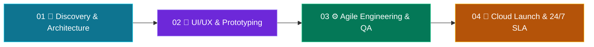

<h1>Syncopsbd - Architecting Next-Gen Software & Digital Solutions</h1>

 

---

## 👋 About Syncopsbd

**Syncopsbd** is an agile software engineering studio based in **Dhaka, Bangladesh**, founded by **Nahidul Islam**. We bridge modern design with enterprise scalability: turnkey web platforms, cross-platform mobile apps, bespoke ERP/CRM systems, and round-the-clock DevOps support.

## 📊 At a Glance

| 🚀 **50+** | 😍 **99.8%** | 🛟 **24/7** | 🔑 **100%** |
|:---:|:---:|:---:|:---:|
| Delivered Solutions | Client Satisfaction | Dedicated Support | Source Code Handover |

## 🛠️ What We Do

| Service | What You Get |
|---|---|
| 🌐 **Website & Web Application Development** | Next.js 16, React, TypeScript & Tailwind CSS. E-commerce with bKash, Nagad, Stripe. SEO-optimized, 99+ Lighthouse score. Admin dashboards & CMS. |
| 📱 **Mobile App Development (iOS & Android)** | Flutter & React Native. Offline-first sync, push notifications, biometrics, Play Store / App Store submission. |
| 🧩 **Custom Software Engineering** | ERP, CRM, POS, School/Hospital Management, HR/Payroll, Supply Chain. RBAC, multi-branch, invoicing, barcode & inventory tracking. |
| ♻️ **Software Modification & Upgrades** | Code refactoring, bug fixing, DB/query optimization, UI/UX redesign, new module integration, with zero data loss. |
| 🛡️ **24/7 Support & Maintenance** | Incident response, daily cloud backups, server scaling (AWS, GCP, Vercel, DigitalOcean), SSL & security audits. |
| 🤖 **API, Cloud & AI Automation** | REST/GraphQL APIs, bKash/Nagad/SSLCommerz/Stripe/PayPal, Bulk SMS & WhatsApp API, Docker/Kubernetes, AI chatbots. |

## 🚀 Our Live Products

| Product | Description | Link |
|---|---|---|
| 🏢 **Syncopsbd Official** | Company website: services, portfolio, careers & contact | [syncopsbd.com](https://syncopsbd.com) |
| 📦 **Inventory & Sales ERP** | Smart stock, billing & hardware POS portal. Multi-unit tracking, real-time alerts, instant billing & printing, customer ledger, role-based access | [inventory.syncopsbd.com](https://inventory.syncopsbd.com) |
| 🔩 **NEW H & BROTHERS** | Inventory & Sales ERP deployment for a hardware business | [new-h-brothers.syncopsbd.com](https://new-h-brothers.syncopsbd.com) |
| ☕ **Cafe & Restaurant POS** | Point-of-sale system for cafes and restaurants | [cafe.syncopsbd.com](https://cafe.syncopsbd.com) |

### ✨ Inventory & Sales ERP Highlights

- 📦 **Inventory, Stocks & Accounts**: multi-unit tracking & real-time alerts
- 🧾 **Point of Sale (POS)**: instant billing, printing & customer ledger
- 🔐 **Role-Based Access**: secure portal for Admin & Sales Managers

## 🧰 Tech Stack

## 🔄 Our Agile Process

| Phase | Key Outputs |
|---|---|
| **01 Discovery & System Architecture** | Architecture diagram, ERD, milestone timeline, transparent budget lock |
| **02 Interactive UI/UX & Prototyping** | Figma hi-fi screens, design system, responsive flows, clickable prototype |
| **03 Agile Engineering & Code Sprints** | Clean documented code, Git access, API & security hardening, QA |
| **04 Cloud Launch & 24/7 SLA** | Zero-downtime deploy, staff training, daily backups, 24/7 support channel |

## 🏆 Featured Works

- 🛒 **OmniSync ERP & Multi-Branch POS**: 28 stores, 3.8x faster checkout (Next.js, Node.js, PostgreSQL, Docker, bKash API)
- 🏥 **HealthPulse Telemedicine App**: 85,000+ users (Flutter, WebRTC, FastAPI, MongoDB, Redis)
- 🏦 **Legacy FinTech Portal Modernization**: -68% CPU load, zero downtime (Next.js, PostgreSQL, Redis)
- 🛍️ **Aura Commerce Headless Store**: 99/100 Lighthouse (Next.js 16, Tailwind, Stripe, SSLCommerz)
- 🚚 **FleetOps Logistics Tracking**: 22.4% fuel cost saved (React, Python, MQTT, AWS IoT)

## 🤝 Why Syncopsbd?

- ✅ **100% IP handover**: full ownership of Git repositories, schemas & source code
- ✅ **Direct founder-level oversight**: zero-middleman accountability
- ✅ **Modern stack**: Next.js 16, Flutter, PostgreSQL, Docker
- ✅ **24/7 SLA support** with a dedicated engineer helpline

## 📬 Let's Build Something Remarkable

| 🌐 Website | 💬 WhatsApp (24/7) | 📧 Email | 📍 HQ |
|:---:|:---:|:---:|:---:|
| [syncopsbd.com](https://syncopsbd.com) | [01943-006504](https://wa.me/8801943006504) | [support@syncopsbd.com](mailto:support@syncopsbd.com) | Dhaka, Bangladesh |

 

© 2026 Syncopsbd. All Rights Reserved. Built with Next.js 16 & Turbopack.

